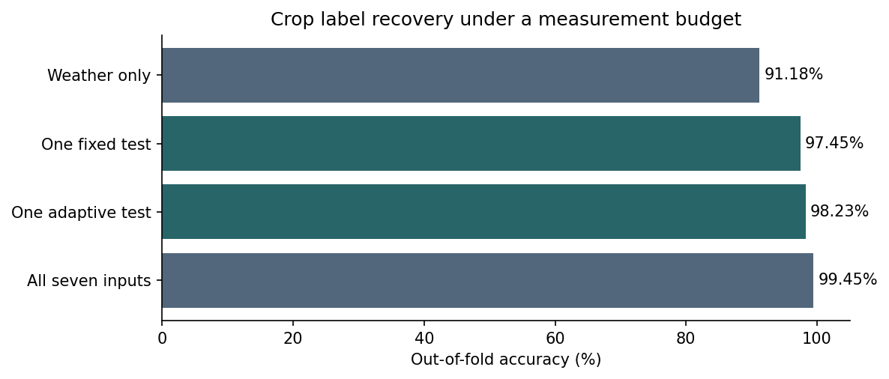

# One Soil Test

**If a crop classifier starts with weather and can ask for just one soil reading, which should it request?** This experiment compares a fixed measurement with a measurement selected from the weather model’s preliminary crop prediction.

[Open the executed notebook in Colab](https://colab.research.google.com/github/imranali-ds/one-soil-test/blob/main/One_Soil_Test.ipynb)

## Research gap

A [Scientific Reports study](https://doi.org/10.1038/s41598-025-07003-8) compares classifiers on complete crop records. A [subsequent reliability study](https://doi.org/10.20935/AcadAI8570) explicitly evaluates weather-only, nutrient-group and perturbation scenarios. We extend these comparisons with a decision at prediction time: choose exactly one of N, P, K or pH before seeing any soil readings. This is a focused empirical question prompted by those studies. The literature review was targeted.

## Findings

| Available measurements | Correct out of 2,200 | Accuracy | Macro F1 |
| --- | ---: | ---: | ---: |
| Three weather readings | 2,006 | 91.18% | 0.9111 |
| Weather + one fixed test | 2,144 | 97.45% | 0.9744 |
| Weather + one adaptive test | 2,161 | 98.23% | 0.9822 |
| All seven readings | 2,188 | 99.45% | 0.9945 |

The adaptive policy corrected 18 fixed-policy errors and introduced one, a net gain of 17 labels (0.77 percentage points). It improved accuracy in all five outer folds. It requested K 1,212 times, P 890 times, N 78 times and pH 20 times. The fixed policy used P in two folds and K in three.

## Experiment

Five stratified outer folds supply one held-out prediction per row. Within each outer training fold, a 70/30 split separates fitting from policy selection. Six random forests share the same fitting rows, seed and tree count: one weather model, four candidate-test models and one full-input model. The fixed policy chooses the best candidate on validation. The adaptive policy groups validation cases by the weather model’s predicted label and switches only when another test recovers at least two additional labels in that group. Test labels and hidden soil readings are excluded from routing. Both one-test policies use the same fitted models.

[Row-level predictions and actions](results/predictions.csv) · [Fold scores](results/folds.csv) · [Metric summary](results/summary.csv)

## Reproduction and data

Run all cells in Colab, or use Python 3.12 with the packages in requirements.txt and open the notebook in Jupyter. The notebook loads the included CSV or retrieves the pinned Fieldwise copy and verifies its SHA-256 checksum. Random seeds, model parameters, routing rule and tie order are recorded in the notebook.

[Dataset listing on Kaggle](https://www.kaggle.com/datasets/atharvaingle/crop-recommendation-dataset) · [Exact CSV used](Crop_recommendation.csv)

The balanced, augmented benchmark contains 100 rows for each of 22 crop classes. Each input is treated as equally costly, while real labs may bundle soil tests. The dataset lacks farm identifiers, measured costs and observed yields. Results quantify label recovery on this particular partition. Testing economic value and transfer to new farms requires geographically identified observations and actual assay prices.
